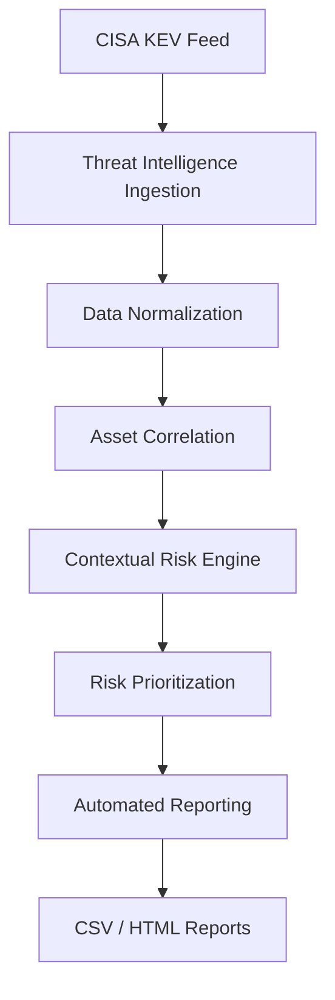

# **Vulnerability Assessment Automation Lab**
**Cybersecurity Engineering | Vulnerability Management | Threat Intelligence**

A Python-based proof of concept demonstrating automated vulnerability intelligence ingestion, asset correlation, contextual risk scoring, and security reporting.

## **1. Project Overview**
This project explores how vulnerability management workflows can be automated using publicly available threat intelligence and a simulated enterprise asset inventory.

The objective is to demonstrate how security teams can:

- Collect vulnerability intelligence from public sources.

- Identify relevant asset exposure.

- Correlate vulnerabilities with affected enterprise assets.

- Prioritize risks using technical and business context.

- Generate actionable security reports.
### **Core Components**
#### **Threat Intelligence Ingestion**
- Retrieve vulnerability intelligence from the CISA Known Exploited Vulnerabilities (KEV) catalog.

- Normalize vulnerability records.

- Extract CVE identifiers, vendors, products, and remediation guidance.
#### **Asset Correlation**
- Maintain a simulated enterprise asset inventory.

- Associate selected vulnerabilities with affected assets.

- Consider asset ownership, environment, exposure, and business criticality.
#### **Risk Scoring**
- Incorporate CVSS severity.

- Consider EPSS exploitation probability.

- Apply CISA KEV prioritization.

- Account for business criticality and network exposure.
#### **Automated Reporting**
- Generate normalized vulnerability CSV files.

- Produce correlated asset-vulnerability records.

- Generate prioritized risk outputs.

- Create an executive HTML report.

## **2. Lab Architecture**

The vulnerability automation pipeline follows this workflow:



### **Workflow Description**
1. **Threat Intelligence Ingestion:** Retrieve vulnerability intelligence from the CISA KEV catalog.

2. **Data Normalization:** Standardize vulnerability records for downstream processing.

3. **Asset Correlation:** Match selected vulnerabilities against the simulated enterprise asset inventory.

4. **Contextual Risk Engine:** Evaluate vulnerabilities using severity, exploitation probability, and asset context.

5. **Risk Prioritization:** Calculate risk scores and rank findings.

6. **Automated Reporting:** Generate structured CSV outputs and an executive HTML report.

## **3. Technology Stack**

| **Technology** | **Purpose** |
| :---: | :---: |
| Ubuntu Linux | Lab operating system |
| Python 3 | Automation and processing |
| Pandas | Data normalization and analysis |
| Requests | Threat intelligence collection |
| Docker | Containerization |
| Docker Compose | Infrastructure orchestration |
| PostgreSQL | Planned persistent storage |
| Redis | Planned caching and job staging |
| Git | Version control |
| GitHub | Source code hosting and documentation |


## **4. Repository Structure**

```text
vuln-automation-lab/
│
├── app/
│   ├── ingest.py
│   ├── correlate.py
│   ├── risk_engine.py
│   ├── reporter.py
│   ├── assets.csv
│   └── requirements.txt
│
├── feeds/
├── db/
├── output/
├── docs/
│
├── docker-compose.yaml
├── requirements.txt
├── run_poc.py
├── README.md
└── .gitignore
```

### **Directory Descriptions**

| **Directory/File** | **Description** |
| :---: | :---: |
| `app/` | Core application modules |
| `ingest.py` | CISA KEV intelligence ingestion |
| `correlate.py` | Asset-vulnerability correlation |
| `risk_engine.py` | Contextual risk scoring |
| `reporter.py` | Automated report generation |
| `assets.csv` | Simulated enterprise asset inventory |
| `feeds/` | Normalized vulnerability intelligence |
| `db/` | Planned database integration |
| `output/` | Generated reports and risk findings |
| `docs/` | Project documentation |
| `docker-compose.yaml` | Container infrastructure configuration |
| `run_poc.py` | Main pipeline execution script |

## **5. Installation and Configuration**

### **Prerequisites**
Ensure the following tools are installed:
- Ubuntu Linux 22.04 or later
- Python 3.11 or later
- Docker Engine
- Docker Compose

### **Step 1: Clone the Repository**
bash
> `git clone [https://github.com/Duriq-Coles-CyberSecurity/vuln-automation-lab.git](https://github.com/Duriq-Coles-CyberSecurity/vuln-automation-lab.git)'

### **Step 2: Create a Python Virtual Environment**
bash
`python3 -m venv venv` ```source venv/bin/activate` 

### **Step 3: Install Dependencies**
Upgrade pip and install the required Python packages:

bash
`python -m pip install --upgrade pip` ```python -m pip install -r requirements.txt` 

### **Step 4: Start Docker Infrastructure**
Start the configured Docker services:

bash
`docker compose up -d` 

Verify the container status:

bash
`docker compose ps` 

## **6. Execute the Vulnerability Automation Pipeline**

Run the complete proof of concept from the project root directory:

bash
`python3 run_poc.py` 

### **Pipeline Execution Stages**
The pipeline executes four primary stages:

| **Stage** | **Script** | **Function** |
| :---: | :---: | :---: |
| 1 | `ingest.py` | CISA KEV ingestion |
| 2 | `correlate.py` | Asset correlation |
| 3 | `risk_engine.py` | Risk prioritization |
| 4 | `reporter.py` | HTML report generation |

The main execution script coordinates these modules to demonstrate an automated vulnerability management workflow.

## **7. Risk Scoring Methodology**
The demonstration risk engine uses a contextual risk scoring formula:

### **Risk Calculation**

```text

`Final Risk Score' = `CVSS ` x  `EPSS ` x `KEV Multiplier ` x `Asset Criticality ` x  `Exposure Multiplier` 

```

### **Demonstration Values**

| **Risk Attribute** | **Example Value** |
| :---: | :---: |
| CVSS | 10.0 |
| EPSS | 0.95 |
| CISA KEV Multiplier | 2.0 |
| Asset Criticality | 2 |
| Internal Exposure Multiplier | 1.0 |

**Important:** These are demonstration values, not live enrichment results.

The formula illustrates how vulnerability severity can be combined with exploitation likelihood and business context to produce a more meaningful risk prioritization model.

The current implementation is intended to demonstrate the methodology rather than provide a validated production risk calculation.

## **8. Expected Output Files**
Following successful execution, the pipeline should generate the following files:

```text
feeds/
└── normalized_kev.csv
output/
├── correlated_vulnerabilities.csv
├── prioritized_risks.csv
└── executive_report.html 
```
### **Output Descriptions**

| **Output File** | **Description** |
| :---: | :---: |
| `normalized_kev.csv` | Standardized CISA KEV vulnerability records |
| `correlated_vulnerabilities.csv` | Demonstration asset-vulnerability matches |
| `prioritized_risks.csv` | Risk-ranked vulnerability findings |
| `executive_report.html` | Automatically generated executive summary |

The executive HTML report provides a consolidated view of the pipeline's vulnerability assessment results.

## **9. Implementation Status**
The following table summarizes the current implementation status of the project.

| **Component** | **Status** |
| :---: | :---: |
| Ubuntu lab environment | Implemented |
| Docker infrastructure configuration | Configured |
| CISA KEV ingestion | Implemented |
| Vulnerability normalization | Implemented |
| Demonstration asset correlation | Implemented |
| Demonstration risk scoring | Implemented |
| HTML report generation | Implemented |
| PostgreSQL application integration | Planned |
| Redis application integration | Planned |
| Live CVSS enrichment | Planned |
| Live EPSS enrichment | Planned |
| Advanced software version matching | Planned |
| FastAPI integration | Planned |

## **10. Future Development Roadmap**

### **Phase 1: Threat Intelligence Expansion**
- Integrate the National Vulnerability Database (NVD).

- Retrieve live EPSS scores.

- Expand vulnerability metadata.

- Improve threat intelligence enrichment.
### **Phase 2: Advanced Asset Correlation**
- Implement CPE-based software identification.

- Improve software version matching.

- Expand asset inventory attributes.

- Improve vulnerability-to-asset correlation accuracy.
### **Phase 3: Database Integration**
- Implement PostgreSQL persistence.

- Introduce historical vulnerability tracking.

- Integrate Redis caching.

- Support persistent vulnerability records.

### **Phase 4: API and Automation**
- Develop FastAPI endpoints.

- Introduce scheduled intelligence ingestion.

- Explore workflow orchestration.

- Expand automation capabilities.

### **Phase 5: Security Dashboard**
- Develop vulnerability analytics.

- Visualize risk trends.

- Improve executive reporting.

- Introduce interactive vulnerability management dashboards.

## **11. Security Disclaimer**
This project is an educational cybersecurity engineering proof of concept intended for authorized defensive security assessment.

The asset inventory and correlation results are simulated. The current risk engine uses demonstration CVSS and EPSS values and does not represent a production vulnerability assessment platform.

**Important considerations:**

- Demonstration asset correlation does not guarantee actual software vulnerability exposure.

- Risk scores are illustrative and should not be treated as validated production risk measurements.

- Live vulnerability enrichment is part of the planned development roadmap.

- Do not use demonstration results as a substitute for validated vulnerability intelligence or production risk assessments.

## **12. Project Information**


| **Attribute** | **Details** |
| :---: | :---: |
| Project | Vulnerability Assessment Automation Lab |
| Platform | Ubuntu Linux |
| Language | Python |
| Project Type | Cybersecurity Engineering Proof of Concept |
| Primary Focus | Vulnerability Management |
| Intelligence Source | CISA KEV Catalog |
| Automation | Python |
| Reporting | CSV / HTML |

### **Focus Areas**
- Cybersecurity Engineering

- Vulnerability Management

- Threat Intelligence

- Security Automation

- Risk Prioritization
### **Repository**
[GitHub – Vulnerability Assessment Automation Lab](https://github.com/Duriq-Coles-CyberSecurity/vuln-automation-lab)

**Project Status:** Proof of Concept

**Development Focus:** Automated vulnerability intelligence ingestion, contextual risk prioritization, and security reporting.

 
